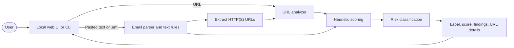

# Capstone 1 Phishing Detector

An offline, rule-based proof of concept that screens one URL, pasted email text, or a raw `.eml` message and returns an explainable heuristic classification. It is designed for an FIU cybersecurity capstone demonstration, not as a production security control.

## Problem and objective

Phishing messages often combine pressure, requests for sensitive information, and misleading link structures. This project demonstrates how transparent rules can identify some of those indicators without visiting links, opening attachments, or sending message content to an external service.

The minimum working model aims to:

- accept URL and email input through a local web interface or command line;
- apply documented, deterministic rules;
- show the score contribution as human-readable findings; and
- communicate limitations without claiming measured detection accuracy.

## Architecture



Detailed and presentation-ready diagrams are indexed in [`docs/SYSTEM_ARCHITECTURE.md`](docs/SYSTEM_ARCHITECTURE.md).

## Implemented features

- URL validation and local parsing; no browsing, redirects, DNS, or reputation lookup.
- URL findings for HTTP, user-info obfuscation, numeric IP hosts, punycode, and login/verification path terms.
- Email findings for urgency/account-threat wording, explicit requests for sensitive information, and HTML link-host mismatches.
- URL extraction from plain text and HTML links; the first 20 unique URLs are inspected.
- `.eml` parsing of Subject, From, `text/plain`, and `text/html`; parts marked as attachments are skipped.
- Exact classifications: `NO INDICATORS FOUND`, `REVIEW RECOMMENDED`, `HIGH RISK`, and URL `INVALID INPUT`.
- Responsive local web UI with reset, validation, escaped text rendering, and optional `.eml` upload.
- Command-line interface for URL, pasted-text, and `.eml` analysis.

**Transferred to a new PC?** Start with [`PC_RECOVERY_GUIDE.md`](PC_RECOVERY_GUIDE.md) and run `TEST_WINDOWS.cmd` before publishing. For the current Codex recovery, verification and private GitHub steps, read [`CODEX_HANDOFF_PC_TO_PRIVATE_GITHUB.md`](CODEX_HANDOFF_PC_TO_PRIVATE_GITHUB.md).

## Requirements

- Python 3.10 or later.
- A current web browser for the graphical interface.
- No package installation, API key, account, database, or internet connection.

The application uses only the Python standard library and bundled HTML/CSS/JavaScript.


## Run it on any teammate's computer

See [TEAMMATE_SETUP.md](TEAMMATE_SETUP.md) for Windows, macOS, and Linux instructions. On Windows, double-click `START_WINDOWS.cmd`. On macOS or Linux, run `sh START_MAC_LINUX.sh`. These launchers start the same localhost Python backend and attempt to open the browser. Python 3.10+ must be installed separately. The UI is **not** a standalone `file://` HTML page; it needs the included backend.

## Run the graphical interface

From the project folder:

```bash
python ui_server.py
```

Open <http://127.0.0.1:8765>. On Windows, try `py ui_server.py` if `python` is not on `PATH`.

The server accepts only `127.0.0.1` as its bind host and checks local Host/Origin headers. Press `Ctrl+C` in the terminal to stop it.

## Run the command-line interface

```bash
python phishing_detector.py
```

Direct examples:

```bash
python phishing_detector.py --url "https://example.org"
python phishing_detector.py --url "http://192.0.2.10/login"
python phishing_detector.py --text "Urgent: enter your password at http://192.0.2.10/login"
python phishing_detector.py --email samples/suspicious_email.eml
```

Example suspicious result:

```text
RESULT: HIGH RISK | heuristic score: 4
 - HTTP used instead of HTTPS (weak indicator on its own)
 - Destination uses a numeric IP address rather than a domain
 - URL path contains login or verification terms (weak indicator)
```

The score is a sum of rule weights, not a percentage or probability.

## Detection summary

| Signal | Weight |
|---|---:|
| HTTP rather than HTTPS | +1 |
| User information before `@` in a URL | +2 |
| Numeric IP address as URL host | +2 |
| Punycode in hostname | +1 |
| Login/verification term in URL path | +1 |
| Urgency or account-threat wording | +1 |
| Explicit sensitive-information request | +2 |
| Displayed URL host differs from HTML link destination | +3 |
| Most suspicious embedded URL | + that URL's score |

Classification thresholds: 0 = `NO INDICATORS FOUND`; 1–2 = `REVIEW RECOMMENDED`; 3 or more = `HIGH RISK`. A malformed URL returns `INVALID INPUT` with score 0 and an explanation.

See [`docs/HOW_IT_WORKS.md`](docs/HOW_IT_WORKS.md) for the complete technical explanation.

For source-backed framework and standards mappings, and a clear separation between implemented heuristics and unimplemented sender authentication, see [`docs/PHISHING_STANDARDS_AND_METHODS.md`](docs/PHISHING_STANDARDS_AND_METHODS.md).

## Testing

```bash
python -m unittest -v
```

The repository contains 20 detector unit tests and 10 local UI/backend integration tests. Passing tests verify expected coded behavior; they do not establish real-world phishing-detection accuracy. See [`docs/TESTING.md`](docs/TESTING.md).

## Limits and safety boundaries

- Email input is limited to 2 MB; the web URL field is limited to 4,096 characters.
- No mailbox access, sender authentication, attachment analysis, live reputation checks, redirects, machine learning, or external APIs.
- Rules are primarily English-language phrases and can produce false positives and false negatives.
- No persistent database is used. The local server processes submissions in memory and does not include their contents in its request log.
- Defanged or escaped display does not make a suspicious message safe.

Read [`docs/LIMITATIONS.md`](docs/LIMITATIONS.md) before presenting results.

## Planned, not implemented

- Evaluate a labeled, ethically sourced dataset and report precision/recall with documented methodology.
- Expand language and encoding coverage.
- Research sender-authentication metadata and attachment handling under a separate, reviewed scope.

These are future-study ideas, not current capabilities.

## Team collaboration

Follow [`CONTRIBUTING.md`](CONTRIBUTING.md). Use a short-lived branch, run all tests, review documentation claims against the code, and open a pull request. The included GitHub Actions workflow runs the same standard-library test suite.

The team repository is [Tyreezebreezy/capstone-phishing-detector](https://github.com/Tyreezebreezy/capstone-phishing-detector) and is private. Classmates must accept an invitation and authenticate before cloning. See [TEAMMATE_SETUP.md](TEAMMATE_SETUP.md).

## AI assistance and attribution

ChatGPT/Codex assisted with the web-interface implementation, test additions, documentation structure, Mermaid diagrams, and validation commands. Human reviewers remain responsible for verifying code, claims, citations, and academic-submission requirements. Details and third-party licensing are in [`docs/PROVENANCE_AND_ETHICS.md`](docs/PROVENANCE_AND_ETHICS.md).

No license has been selected for the group's original project code. Do not assume permission to redistribute beyond the team's academic use until the team chooses and records a license.

## References

- [NIST phishing guidance](https://www.nist.gov/itl/smallbusinesscyber/guidance-topic/phishing)
- [Python email parser documentation](https://docs.python.org/3/library/email.parser.html)
- [Python `urllib.parse` documentation](https://docs.python.org/3/library/urllib.parse.html)
- [ACM Code of Ethics](https://www.acm.org/code-of-ethics)
- [Mermaid](https://mermaid.js.org/)
