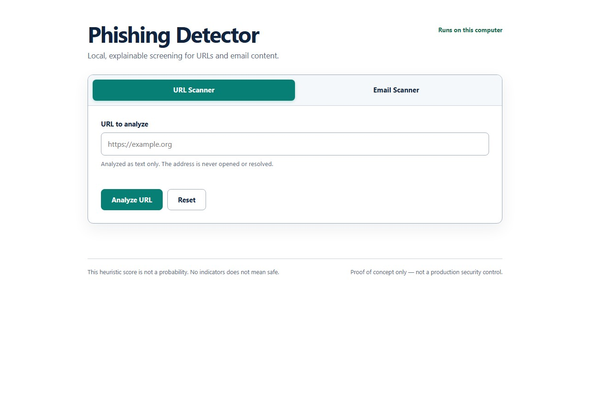

# Capstone 1 Phishing Detector

A local, rule-based phishing screening prototype for URLs and email content. It explains which warning signs were found, assigns a heuristic score, and presents the result through a web interface or command line.

Built as a student cybersecurity project, the detector uses Python's standard library and bundled HTML, CSS, and JavaScript. It runs offline after setup, without API keys, package installation, or a shared server.

> A score is not a probability. **No indicators found does not mean safe.** This proof of concept is not a production security control.



## What it does

- **URL screening:** checks HTTP use, user information before `@`, numeric IP hosts, punycode, and selected login or verification path terms.
- **Email screening:** checks fixed English urgency and sensitive-information phrases, extracts HTTP(S) links, and analyzes the first 20 unique links.
- **`.eml` support:** reads subject, sender, and supported text/HTML MIME parts; compares URL-like anchor text with its destination hostname. Pasted messages are treated as plain text.
- **Explainable results:** shows the classification, score, triggered rules, and individual embedded-URL findings.
- **Local handling:** does not visit submitted links, resolve hostnames, execute attachments, or send analysis inputs to an external service.

## Install and run

Requirements: **Python 3.10 or newer** and a modern browser. Git is optional if downloading a ZIP.

This repository is private. Accept the owner's invitation and authenticate to GitHub before cloning, or use **Code → Download ZIP** and extract it. See [teammate setup](TEAMMATE_SETUP.md) for authentication and troubleshooting.

```bash
git clone https://github.com/Tyreezebreezy/capstone-phishing-detector.git
cd capstone-phishing-detector
```

| Platform | Start the web interface | Run tests |
|---|---|---|
| Windows | Double-click `START_WINDOWS.cmd`, or run `py -3 launch.py` | Double-click `TEST_WINDOWS.cmd`, or run `py -3 -m unittest discover -v` |
| macOS / Linux | `sh START_MAC_LINUX.sh`, or `python3 launch.py` | `sh TEST_MAC_LINUX.sh`, or `python3 -m unittest discover -v` |

The launcher opens <http://127.0.0.1:8765>. Keep its terminal open; press **Ctrl+C** there to stop. Each teammate runs a separate copy on their own computer. Opening `web/index.html` directly does not start the backend.

If port 8765 is occupied, use `py -3 launch.py --port 8766` on Windows or `python3 launch.py --port 8766` on macOS/Linux. `--no-browser` starts the server without opening a browser tab. No `pip install` step is needed.

## Try a scan

Choose **URL Scanner** to enter a URL, or **Email Scanner** to paste text or upload an `.eml` file. If both text and a file are present, the file takes precedence. **Reset** clears both forms and the results.

These synthetic examples give reproducible demonstrations:

| Input | Expected result |
|---|---|
| `https://example.org` | Score 0 — `NO INDICATORS FOUND` |
| `http://example.org` | Score 1 — `REVIEW RECOMMENDED` |
| `http://192.0.2.10/login` | Score 4 — `HIGH RISK` |
| `samples/normal_email.eml` | Score 0 — `NO INDICATORS FOUND` |
| `samples/suspicious_email.eml` | Score 10 — `HIGH RISK` |
| `javascript:alert(1)` | `INVALID INPUT`, score 0 |

The command-line interface uses the same engine. Run these from the project folder (`python3` in place of `py -3` on macOS/Linux):

```powershell
py -3 phishing_detector.py --url "http://192.0.2.10/login"
py -3 phishing_detector.py --text "Urgent: enter your password at http://192.0.2.10/login"
py -3 phishing_detector.py --email samples/suspicious_email.eml
```

Run `py -3 phishing_detector.py` without arguments for the interactive menu.

## How it works

`phishing_detector.py` parses the input and applies fixed rules. URL findings add their weights. Email scoring combines wording and HTML-link findings with **only the highest score** among the inspected embedded URLs, rather than summing every URL score.

| Score | Classification |
|---|---|
| 0 | `NO INDICATORS FOUND` |
| 1–2 | `REVIEW RECOMMENDED` |
| 3 or more | `HIGH RISK` |

Invalid URLs return a separate `INVALID INPUT` result. The [rule reference](docs/HOW_IT_WORKS.md) documents every weight, parsing step, and boundary.

The web interface calls three local endpoints in `ui_server.py`, which delegate to the same engine used by the CLI. The provided launchers bind to `127.0.0.1`. Results are rendered as text, and the server allowlists static files and checks request size, Host, and supplied Origin headers.

## Tests

The suite contains **30 tests: 20 detector tests and 10 HTTP/UI integration tests**. Run the platform command above from the repository root. Integration tests start a temporary loopback server; they need permission to open local sockets.

[GitHub Actions](https://github.com/Tyreezebreezy/capstone-phishing-detector/actions/workflows/tests.yml) runs the suite on Ubuntu with Python 3.10, 3.11, 3.12, and 3.13 for pushes and pull requests. See [testing and validation](docs/TESTING.md) for coverage, manual UI checks, and platform limits. Passing synthetic tests does not establish real-world detection accuracy.

## Limitations

The rules can produce false positives and miss phishing. No labeled real-world dataset has been evaluated. Sender headers are displayed, not authenticated. There is no SPF, DKIM, DMARC, reputation lookup, DNS resolution, redirect expansion, website inspection, machine learning, or attachment analysis.

The web interface limits URLs to 4,096 characters and email text/files to 2,000,000 bytes, with a separate JSON request-body cap. The `.eml` parser also enforces that file-size limit; CLI text input has no separate size limit. HTML parsing is structural, not browser rendering, and MIME coverage is limited. See [limitations and responsible use](docs/LIMITATIONS.md).

## Project guide

| File or directory | Purpose |
|---|---|
| `phishing_detector.py` | Detection rules, parsers, scoring, and CLI |
| `ui_server.py`, `launch.py` | Local HTTP API, static assets, and browser launcher |
| `web/` | Browser interface |
| `test_detector.py`, `test_ui_server.py` | Unit and integration tests |
| `samples/` | Two synthetic email fixtures |
| `docs/`, `docs/diagrams/` | Technical documentation and editable/rendered diagrams |
| `screenshots/` | Example interface views |

- [Teammate setup](TEAMMATE_SETUP.md) and [contributing](CONTRIBUTING.md)
- [System architecture and diagrams](docs/SYSTEM_ARCHITECTURE.md)
- [Standards and methodology](docs/PHISHING_STANDARDS_AND_METHODS.md)
- [Development provenance and acknowledgments](docs/DEVELOPMENT_PROVENANCE.md)

No project license has been selected. Third-party component licenses are recorded in the provenance document; the team must decide how to license its own work before public redistribution.
