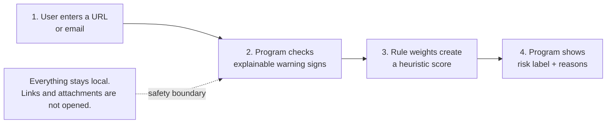
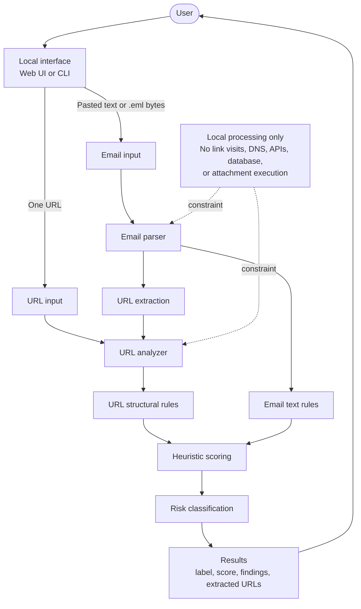
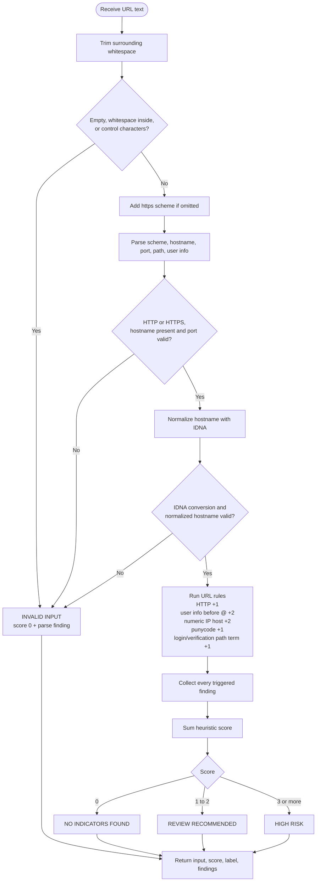
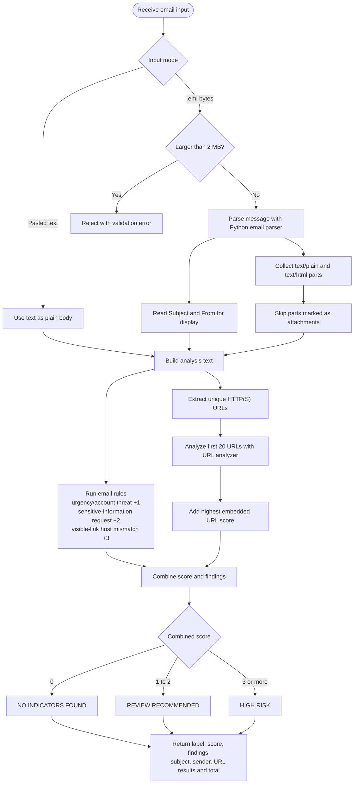
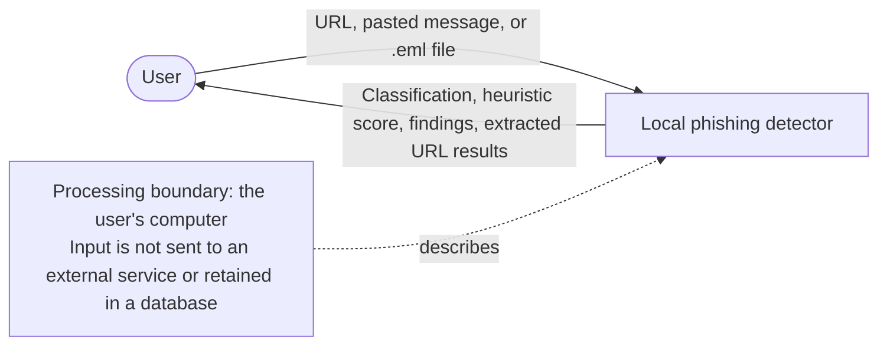
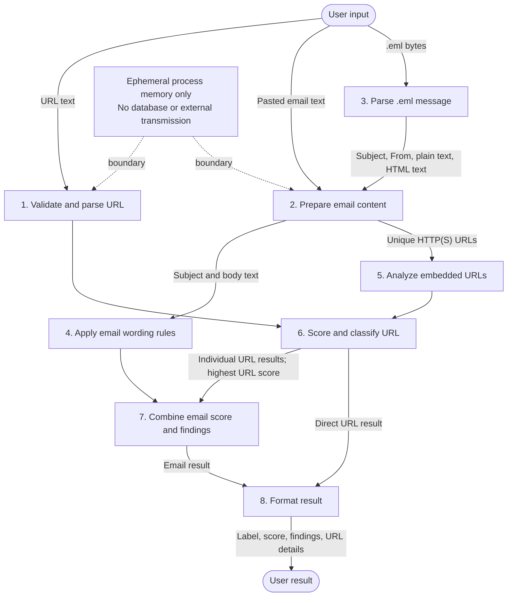
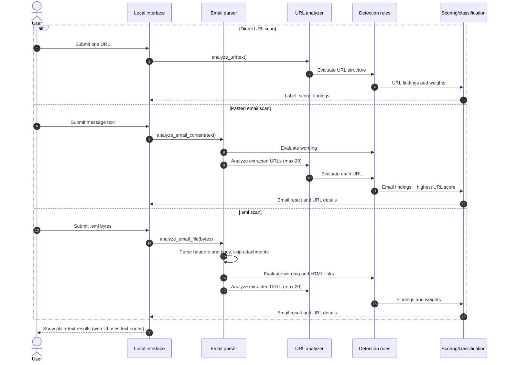
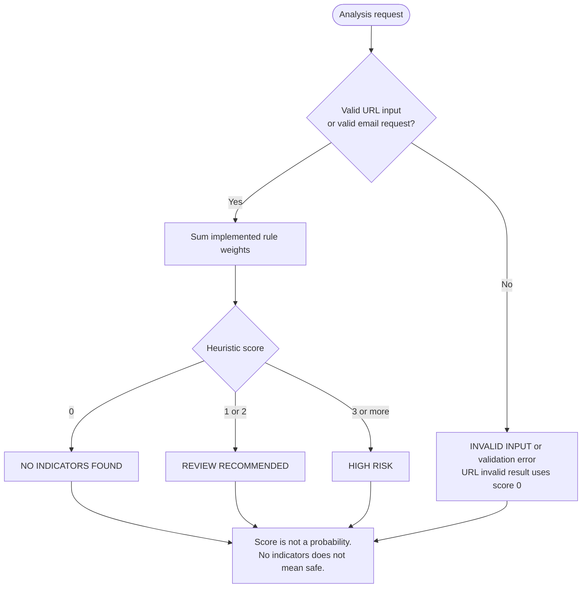
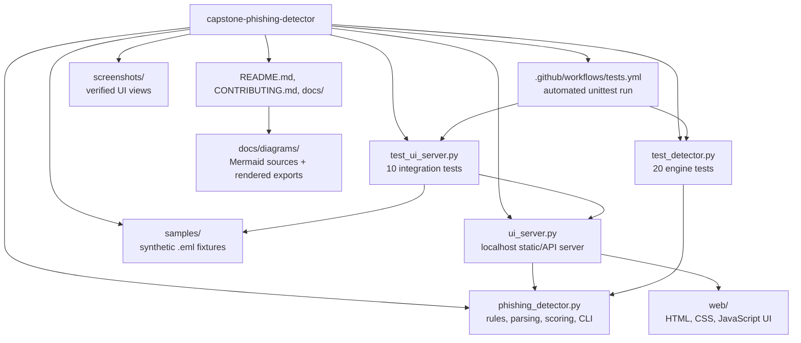
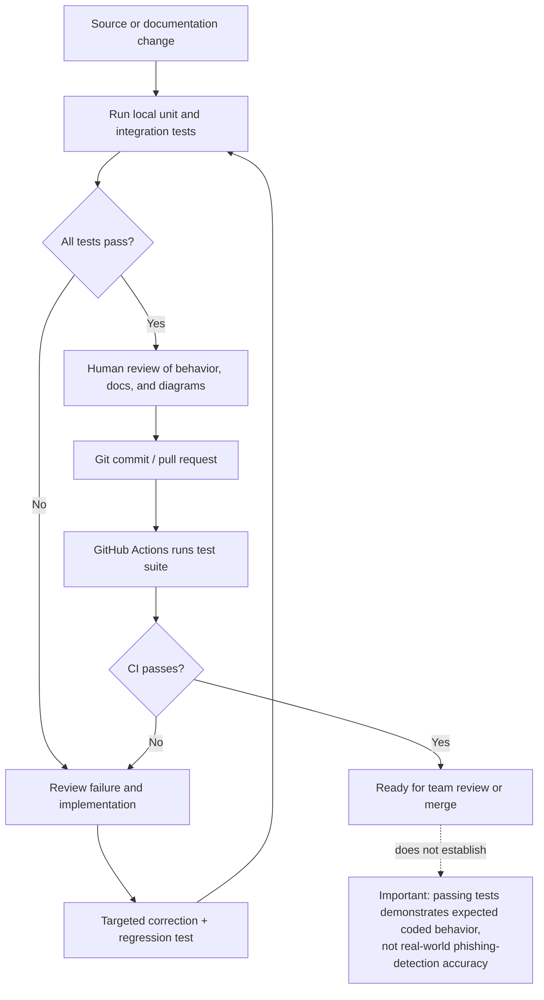

# System Architecture

All diagrams describe the audited implementation. Editable sources are in [`diagrams/`](diagrams/); rendered SVG and PNG exports are in [`diagrams/rendered/`](diagrams/rendered/).

The shared visual language uses teal for application processes, navy text, neutral data movement, and amber notes. No diagram introduces a database, cloud service, reputation API, mailbox connection, attachment engine, or machine-learning component.

## Overview

This simplified view is intended for an audience unfamiliar with the code.



Source: [`simplified-overview.mmd`](diagrams/simplified-overview.mmd)

## A. High-level system architecture

The direct URL path and email path converge at the URL analyzer and scoring/classification logic. Results return to the same local interface.



Source: [`system-architecture.mmd`](diagrams/system-architecture.mmd)

## B. URL detection flowchart

Invalid URL input is handled before rule scoring. Valid URLs pass through the five implemented structural rules.



Source: [`url-analysis.mmd`](diagrams/url-analysis.mmd)

## C. Email detection flowchart

The sender header is displayed but not authenticated or scored. The parser skips individual MIME parts marked as attachments and analyzes supported text parts. Nested-container limits are described in [limitations](LIMITATIONS.md).



Source: [`email-analysis.mmd`](diagrams/email-analysis.mmd)

## D1. Data flow — Level 0 context



Source: [`data-flow-level-0.mmd`](diagrams/data-flow-level-0.mmd)

## D2. Data flow — Level 1

Input is held only as needed in process memory. The project has no persistence layer. The server's request log contains method, path, status, and client address—not submitted message bodies.



Source: [`data-flow-level-1.mmd`](diagrams/data-flow-level-1.mmd)

## E. Sequence diagram

The “local interface” participant represents either the web UI/server pair or the CLI. Both call the same detection engine. Rules and scoring are conceptual steps within that engine, not separate services. Pasted input is plain text; HTML-link checks apply to parsed HTML email parts.



Source: [`sequence.mmd`](diagrams/sequence.mmd)

## F. Scoring and classification logic



Source: [`scoring.mmd`](diagrams/scoring.mmd)

## G. Repository component diagram



Source: [`components.mmd`](diagrams/components.mmd)

## H. Testing and validation workflow

Passing tests demonstrate agreement with selected expected cases. They are not an independent measurement of phishing-detection quality.



Source: [`testing-workflow.mmd`](diagrams/testing-workflow.mmd)

## Maintaining the diagrams

Keep each editable `.mmd` source, its embedded diagram above, and both rendered exports synchronized. The source theme uses teal processes, navy text, and neutral edges. SVG supports scalable viewing; PNG is useful in slides and document editors.

With Node.js/npm installed, render a source using the pinned documentation tool:

```bash
npx -y @mermaid-js/mermaid-cli@11.12.0 -i docs/diagrams/components.mmd -o docs/diagrams/rendered/components.svg -b transparent
npx -y @mermaid-js/mermaid-cli@11.12.0 -i docs/diagrams/components.mmd -o docs/diagrams/rendered/components.png -b white -w 1800
```

Repeat for each changed source, then inspect labels, arrows, clipping, and consistency with the implementation. These commands can download documentation tooling and its browser dependency; Mermaid and Node.js are not application runtime requirements. Record rendering and review results in the pull request.
